# Три варианта сайта ВиК — сравнение (обновлено 02.11.2026)

Все три собираются без ошибок (по 32 страницы: 5 направлений, 12 услуг, база знаний из 6 статей, компания, проекты, документы, контакты, юр. страницы), закрыты от индексации (noindex + robots.txt), тексты общие из `vik-site/src/content/`, проверка текстов — 0 ошибок, «Потенциал» нигде не встречается. Ничего не выложено.

| | V1 «Золото» | V2 «Прогрессив из КП» | V3 «Индиго» |
|---|---|---|---|
| Папка | `vik-site/` | `vik-variants/v2-kp/` | `vik-variants/v3-indigo/` |
| Поддомен при выкладке | gold.vikmsk.ru | kp.vikmsk.ru | indigo.vikmsk.ru |
| Стиль | чёрный мрамор + золото, эмблема Виталия | графит + изумруд, редакционная подача, как слайды КП | тёмно-синий, чертёжная сетка, синий треугольник из первых эскизов |
| Опора на пожелания Виталия | утверждённая эмблема и цвета, принципы, слоган | концепция №6: реальные трубы, вертикальная лента этапов | концепция №1: здание и сети под ним в разрезе; «треугольник, индиго» (24.09) |
| Главный эффект | параллакс первого экрана, золотой трубопровод рисуется при прокрутке | изумрудная труба выходит из ленты этапов и тянется до формы | изометрическая сцена: грунт → 5 систем → здание → этапы, собирается при прокрутке |
| Страницы направлений | свой оттенок, анимированная схема системы, фото глубже | крупное фото/схема, редакционный текст | изометрическая схема своей системы с выносками, фото ниже |
| Слабые места | эмблема растровая; для воды и газа ИИ-кадры | кадр первого экрана мягковат на больших экранах | сцена длинная (~5 экранов); на телефоне текст шага под сценой; знак перерисован агентом — согласовать |

Общее для всех: для воды и газа нет реальных фото (нужны 2–4 фото от Виталия); ОГРНИП и номера СРО стоят плейсхолдерами `XXXX`; адрес «г. Москва».

**Обновления 02.11:** тексты направлений углублены (ситуации, маршрут, нормативы со сверкой, ошибки, FAQ), 3 новые услуги (техприсоединение и ТУ, вынос сетей, экспертиза), база знаний; у каждой страницы своя композиция и визуализация в каждом варианте; ИИ-иллюстрации воды/газа/теплосети; видео первого экрана в V1 и V2; интро со сборкой эмблемы в V1, прорисовка знака в V2; страница выбора `vik-variants/chooser/`. Скриншоты волны 2 — `screens/w2-*` в каждой папке.

## V1 «Золото»

| Компьютер | Телефон |
|---|---|
| 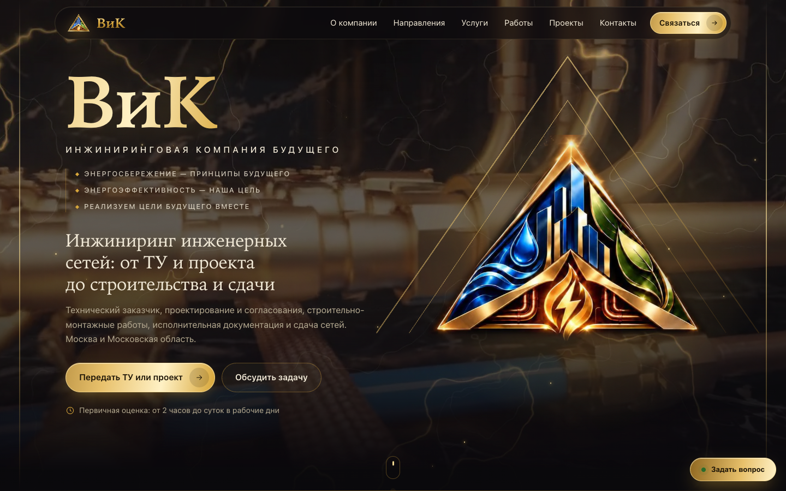 | 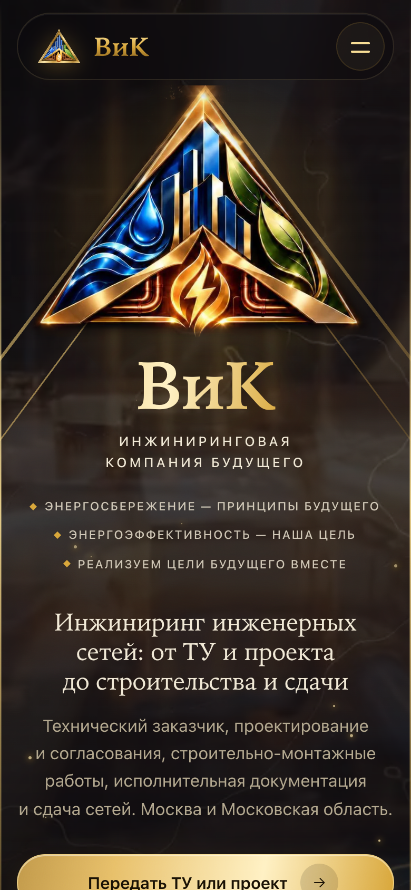 |
| 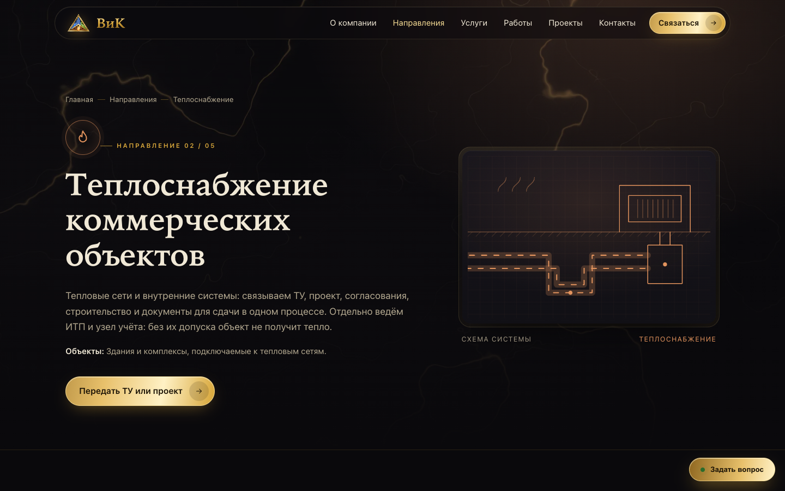 | 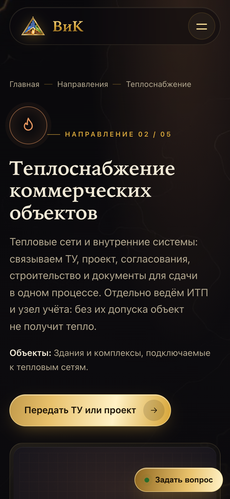 |

## V2 «Прогрессив из КП»

| Компьютер | Телефон |
|---|---|
| 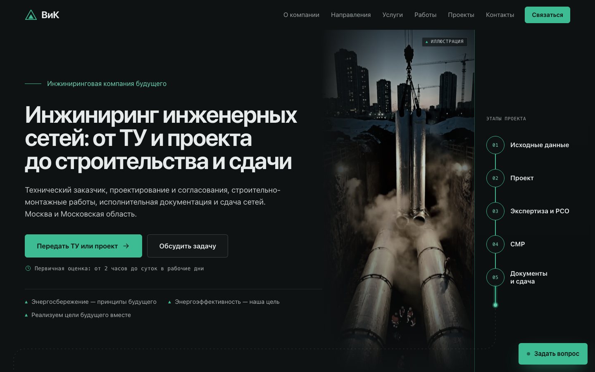 | 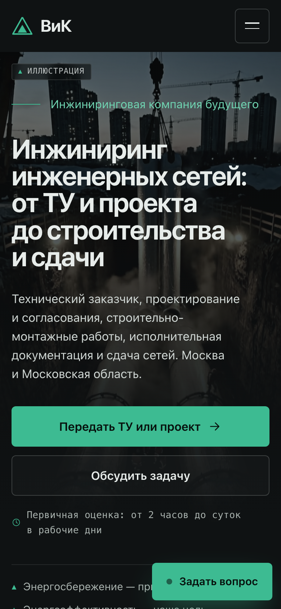 |
| 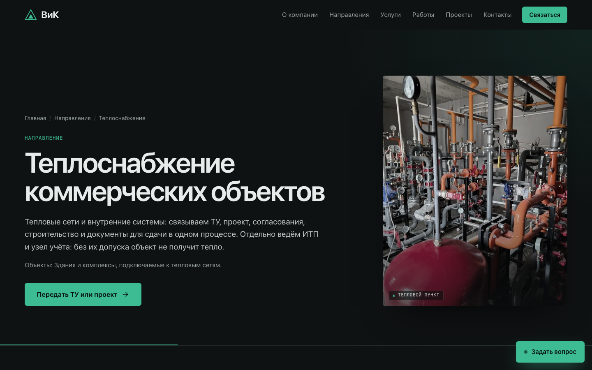 | 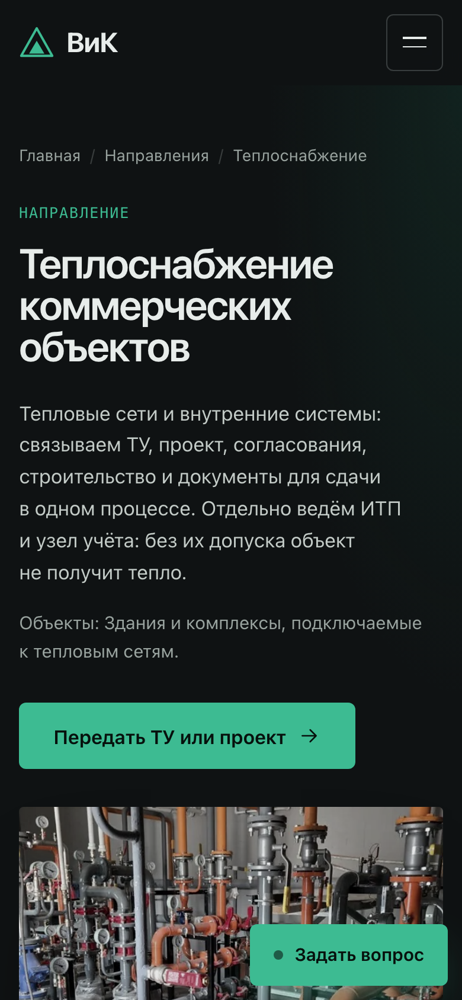 |

## V3 «Индиго»

| Компьютер | Телефон |
|---|---|
| 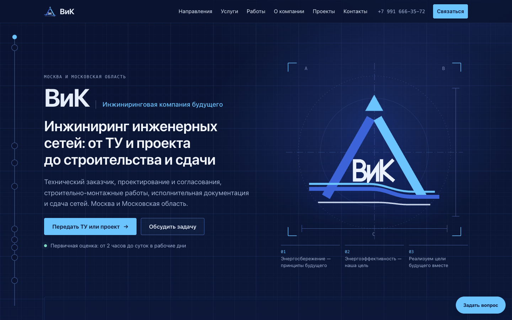 | 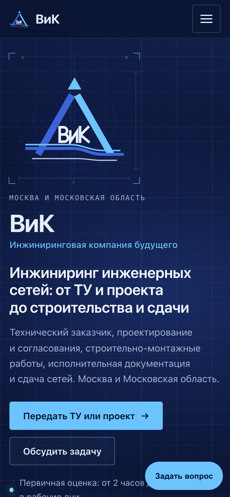 |
| 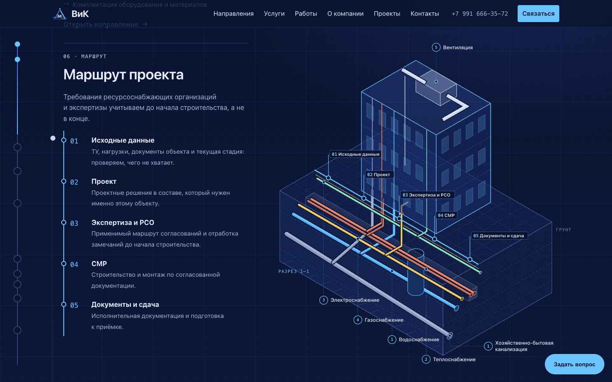 | 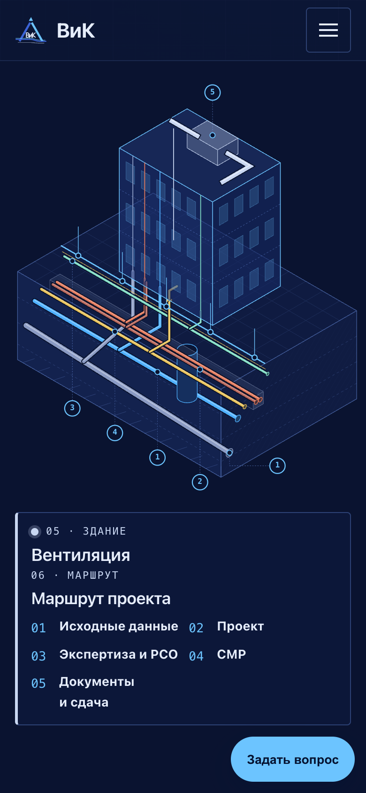 |
| 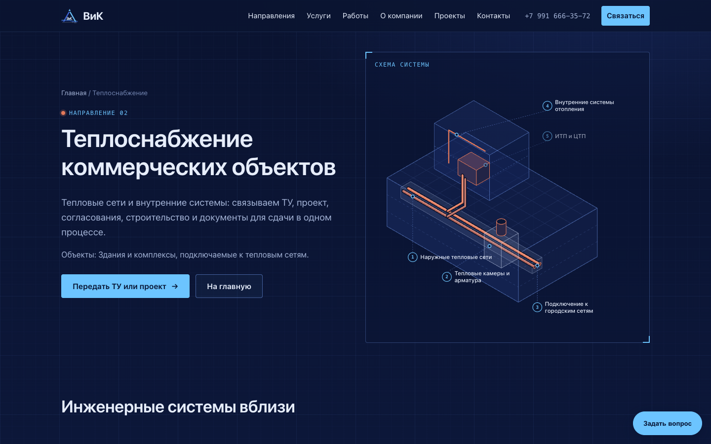 | 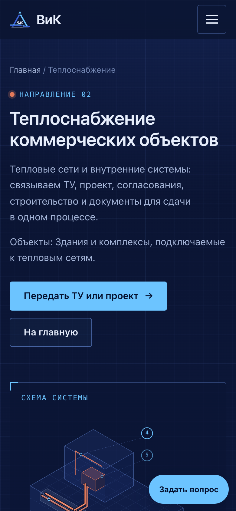 |

## Выкладка вечером

1. DNS: A-запись `*.vikmsk.ru` (или gold/kp/indigo) на IP сервера.
2. Блок из `vik-variants/deploy/Caddyfile.variants` добавить в Caddyfile сервера.
3. `DEPLOY_HOST=user@IP ./vik-variants/deploy/deploy-variants.sh` (все три) или с аргументом `v1`/`v2`/`v3`.

После выбора Виталием: выбранный вариант ставим на vikmsk.ru, остальные поддомены выключаем.
